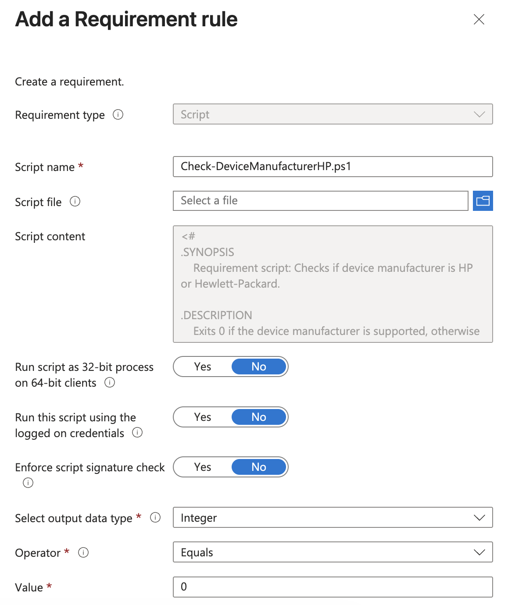

# WXP Insights

> [!NOTE]  
> Additional requirement rule script for Intune is here: [Check-DeviceManufacturerHP.ps1](./Check-DeviceManufacturerHP.ps1)
> This script will make sure, that WXP Insight will be deployed only to HP-devices.
> Screenshot of deployment settings:
> <tr>
> <kbd> </kbd>

## PSAppDeployToolkit (PSADT)

### Variables (Example)
```powershell
##================================================
## MARK: Variables
##================================================

# Zero-Config MSI support is provided when "AppName" is null or empty.
# By setting the "AppName" property, Zero-Config MSI will be disabled.
$adtSession = @{
    # App variables.
    AppVendor = 'HP Inc.'
    AppName = 'WXP Insights'
    AppVersion = '5.26.150'
    AppArch = 'x86'
    AppLang = 'EN'
    AppRevision = '01'
    AppSuccessExitCodes = @(0)
    AppRebootExitCodes = @(1641, 3010)
    AppProcessesToClose = @('HPTouchpointManagerTray')  # Example: @('excel', @{ Name = 'winword'; Description = 'Microsoft Word' })
    AppScriptVersion = '1.0.0'
    AppScriptDate = '2026-11-23'
    AppScriptAuthor = 'Jan Parttimaa'
    RequireAdmin = $true

    # Install Titles (Only set here to override defaults set by the toolkit).
    InstallName = ''
    InstallTitle = 'WXP Insights'

```


### Pre-Installation

The following setting has been configured in the pre-install phase to prevent users from deferring installation or uninstallation: ```DeferTimes = 0```.

```powershell
    ## <Perform Pre-Installation tasks here>

    # Setting variable
    $Company = "Contoso"
    
    # Checking if device manufacturer is HP or Hewlett-Packard. If not, we will inform this and cancel the installation. 
    # This is because WXP Insight is only for HP-devices. 
    # If device manufacturer is HP or Hewlett-Packard, we can proceed.
    # For close the installation if devcie manufacturer is not HP or Hewlett-Packard, we will use custom exit code 69000 recommended by PSAppDeployToolkit.
    
    # Stop script execution on any error
    $ErrorActionPreference = 'Stop'

    try {
        # Retrieve manufacturer information from the system
        $Manufacturer = (Get-CimInstance -ClassName Win32_ComputerSystem).Manufacturer

        # Normalize the value:
        # - Trim whitespace
        # - Convert to lowercase for consistent comparison
        # - Remove dots to handle "HP.inc" vs "HP Inc."
        $Normalized = $Manufacturer.Trim().ToLower() -replace '\.', ''

        Write-ADTLogEntry -Message "Detected device manufacturer: $Manufacturer" -Source "Info"
        Write-ADTLogEntry -Message "Normalized value: $Normalized" -Source "Info"

        # Check if manufacturer matches allowed values
        if (
            $Normalized -eq "hp" -or
            $Normalized -eq "hp inc" -or
            $Normalized -eq "hewlett-packard" -or
            $Normalized -eq "hewlett packard"
        ) {
            Write-ADTLogEntry -Message "Requirement satisfied: Supported device manufacturer" -Source "Info"
        }
        else {
            Write-ADTLogEntry -Message "Requirement not met: Unsupported device manufacturer" -Source "Info"
            Show-ADTInstallationPrompt -Title "$($adtSession.AppName)" -Message "Requirement not met: Unsupported device manufacturer. This application can be only installed to HP-devices. We cannot proceed installation of $($adtSession.AppName)." -MessageAlignment "Left" -ButtonRightText "OK" -NoWait
            Close-ADTSession -ExitCode 69000
        }
    }
    catch {
        # Handle unexpected errors
        Write-ADTLogEntry -Message "Requirement check failed: $($_.Exception.Message)" -Source "Info"
        Show-ADTInstallationPrompt -Title "$($adtSession.AppName)" -Message "Requirement check failed: $($_.Exception.Message). We cannot proceed installation of $($adtSession.AppName)." -MessageAlignment "Left" -ButtonRightText "OK" -NoWait
        Close-ADTSession -ExitCode 69000
    }

    # Checking if prerequired application is installed (1/2): Microsoft Visual C++ 2015-2022 Redistributable (x86).
    # If not, it will be installed. Otherwise, we don't need to install anything before installing WXP Insights Agent.
    Write-ADTLogEntry -Message "Checking does device have following prerequisite application installed (1/2): Microsoft Visual C++ 2015-2022 Redistributable (x86)" -Source "Info"

    $VCRedistx86 = Get-ADTApplication -Name "Microsoft Visual C++ 2015-2022 Redistributable (x86)" -NameMatch "Contains"

    if($VCRedistx86) {
        Write-ADTLogEntry -Message "Microsoft Visual C++ 2015-2022 Redistributable (x86) already installed. No need to install it. Let's continue..." -Source "Info"
    } else {
        Write-ADTLogEntry -Message "Microsoft Visual C++ 2015-2022 Redistributable (x86) not installed. This is pre-requirement (1/2) for WXP Insights. Installing it now..." -Source "Info"
        Start-ADTProcess -FilePath "vc_redist.x86.exe" -ArgumentList "/install /quiet /norestart"
    }

    # Checking if prerequired application is installed (2/2): Microsoft Visual C++ 2015-2022 Redistributable (x64).
    # If not, it will be installed. Otherwise, we don't need to install anything before installing WXP Insights Agent.
    Write-ADTLogEntry -Message "Checking does device have following prerequisite application installed (2/2): Microsoft Visual C++ 2015-2022 Redistributable (x64)" -Source "Info"

    $VCRedistx64 = Get-ADTApplication -Name "Microsoft Visual C++ 2015-2022 Redistributable (x64)" -NameMatch "Contains"

    if($VCRedistx64) {
        Write-ADTLogEntry -Message "Microsoft Visual C++ 2015-2022 Redistributable (x64) already installed. No need to install it. Let's continue..." -Source "Info"
    } else {
        Write-ADTLogEntry -Message "Microsoft Visual C++ 2015-2022 Redistributable (x64) not installed. This is pre-requirement (2/2) for WXP Insights. Installing it now..." -Source "Info"
        Start-ADTProcess -FilePath "vc_redist.x64.exe" -ArgumentList "/install /quiet /norestart"
    }

    # Uninstallation of previous installation of WXP Insights, WXP Insights Analytics and WXP Insights Analytics - Dependencies
    Write-ADTLogEntry -Message "Uninstallation process of previous 'WXP Insights', 'WXP Insights Analytics Client' and 'WXP Insights Analytics - Dependencies' applications started..." -Source "Info"

    # Reset the consent to unknown
    Write-ADTLogEntry -Message "Resetting Consent to unknown..." -Source "Info"
    Set-ADTRegistryKey -LiteralPath "HKEY_LOCAL_MACHINE\SOFTWARE\Policies\HP\Consent" -Name "AllowMarketing" -Value "Unknown" -Type String
    Set-ADTRegistryKey -LiteralPath "HKEY_LOCAL_MACHINE\SOFTWARE\Policies\HP\Consent" -Name "AllowNecessary" -Value "Unknown" -Type String
    Set-ADTRegistryKey -LiteralPath "HKEY_LOCAL_MACHINE\SOFTWARE\Policies\HP\Consent" -Name "AllowProductEnhancement" -Value "Unknown" -Type String
    Set-ADTRegistryKey -LiteralPath "HKEY_LOCAL_MACHINE\SOFTWARE\Policies\HP\Consent" -Name "AllowSupport" -Value "Unknown" -Type String
    Set-ADTRegistryKey -LiteralPath "HKEY_LOCAL_MACHINE\SOFTWARE\Policies\HP\Consent" -Name "AnyConsentWasAccepted" -Value "Unknown" -Type String
    Set-ADTRegistryKey -LiteralPath "HKEY_LOCAL_MACHINE\SOFTWARE\Policies\HP\Consent" -Name "AllowTransferOutOfCountry" -Value "Unknown" -Type String
    Write-ADTLogEntry -Message "Consent has set to unknown." -Source "Info"

    # Disabling HP services
    Write-ADTLogEntry -Message "Disabling HP Services..." -Source "Info"

    if (Get-Service -Name "hpsvcsscan" -ErrorAction SilentlyContinue) {
        Write-ADTLogEntry -Message "Following service exist: HP Services Scan (hpsvcsscan). Proceeding..." -Source "Info"
        Write-ADTLogEntry -Message "Disabling service: HP Services Scan (hpsvcsscan)..." -Source "Info"
        Stop-ADTServiceAndDependencies -Name "hpsvcsscan"
        Set-ADTServiceStartMode -Service "hpsvcsscan" -StartMode "Disabled"
        Write-ADTLogEntry -Message "Service disabled: HP Services Scan (hpsvcsscan)" -Source "Info"
    } else {
        Write-ADTLogEntry -Message "Following service does not exist: HP Services Scan (hpsvcsscan). Proceeding..." -Source "Info"
    }

    if (Get-Service -Name "hptpsmarthealthservice" -ErrorAction SilentlyContinue) {
        Write-ADTLogEntry -Message "Following service exist: 'hptpsmarthealthservice'. Proceeding..." -Source "Info"
        Write-ADTLogEntry -Message "Disabling service: 'hptpsmarthealthservice'..." -Source "Info"
        Stop-ADTServiceAndDependencies -Name "hptpsmarthealthservice"
        Set-ADTServiceStartMode -Service "hptpsmarthealthservice" -StartMode "Disabled"
        Write-ADTLogEntry -Message "Service disabled: 'hptpsmarthealthservice'" -Source "Info"
    } else {
        Write-ADTLogEntry -Message "Following service does not exist:  'hptpsmarthealthservice'. Proceeding..." -Source "Info"
    }

    if (Get-Service -Name "HpTouchpointAnalyticsService" -ErrorAction SilentlyContinue) {
        Write-ADTLogEntry -Message "Following service exist: WXP Insights Analytics (HpTouchpointAnalyticsService). Proceeding..." -Source "Info"
        Write-ADTLogEntry -Message "Disabling service: WXP Insights Analytics (HpTouchpointAnalyticsService)..." -Source "Info"
        Stop-ADTServiceAndDependencies -Name "HpTouchpointAnalyticsService"
        Set-ADTServiceStartMode -Service "HpTouchpointAnalyticsService" -StartMode "Disabled"
        Write-ADTLogEntry -Message "Service disabled: WXP Insights Analytics (HpTouchpointAnalyticsService)" -Source "Info"
    } else {
        Write-ADTLogEntry -Message "Following service does not exist: WXP Insights Analytics (HpTouchpointAnalyticsService). Proceeding..." -Source "Info"
    }

    if (Get-Service -Name "hpLHAgent" -ErrorAction SilentlyContinue) {
        Write-ADTLogEntry -Message "Following service exist: WXP Insights Agent (hpLHAgent). Proceeding..." -Source "Info"
        Write-ADTLogEntry -Message "Disabling service: WXP Insights Agent (hpLHAgent)..." -Source "Info"
        Stop-ADTServiceAndDependencies -Name "hpLHAgent"
        Set-ADTServiceStartMode -Service "hpLHAgent" -StartMode "Disabled"
        Write-ADTLogEntry -Message "Service disabled: WXP Insights Agent (hpLHAgent)" -Source "Info"
    } else {
        Write-ADTLogEntry -Message "Following service does not exist: WXP Insights Agent (hpLHAgent). Proceeding..." -Source "Info"
    }

    if (Get-Service -Name "hpLHWatchdog" -ErrorAction SilentlyContinue) {
        Write-ADTLogEntry -Message "Following service exist: WXP Insights WatchDog Service (hpLHWatchdog). Proceeding..." -Source "Info"
        Write-ADTLogEntry -Message "Disabling service: WXP Insights WatchDog Service (hpLHWatchdog)..." -Source "Info"
        Stop-ADTServiceAndDependencies -Name "hpLHWatchdog"
        Set-ADTServiceStartMode -Service "hpLHWatchdog" -StartMode "Disabled"
        Write-ADTLogEntry -Message "Service disabled: WXP Insights WatchDog Service (hpLHWatchdog)" -Source "Info"
    } else {
        Write-ADTLogEntry -Message "Following service does not exist: WXP Insights WatchDog Service (hpLHWatchdog). Proceeding..." -Source "Info"
    }

    # Uninstall the applications
    Write-ADTLogEntry -Message "Uninstalling the applications..." -Source "Info"
    #Stop-ADTServiceAndDependencies -Name "HPTouchpointManagerTray"
    Uninstall-ADTApplication -Name "WXP Insights Agent" -NameMatch "Exact" -FilterScript { $_.Publisher -match "HP Inc." } -IgnoreExitCodes "*"
    Uninstall-ADTApplication -Name "HP Insights" -NameMatch "Exact" -FilterScript { $_.Publisher -match "HP Inc." } -IgnoreExitCodes "*"
    Uninstall-ADTApplication -Name "WXP Insights Analytics" -NameMatch "Exact" -FilterScript { $_.Publisher -match "HP Inc." } -IgnoreExitCodes "*"
    Uninstall-ADTApplication -Name "HP Insights Analytics" -NameMatch "Exact" -FilterScript { $_.Publisher -match "HP Inc." } -IgnoreExitCodes "*"
    Uninstall-ADTApplication -Name "WXP Insights Analytics - Dependencies" -NameMatch "Exact" -FilterScript { $_.Publisher -match "HP Inc." } -IgnoreExitCodes "*"
    Uninstall-ADTApplication -Name "HP Insights Analytics - Dependencies" -NameMatch "Exact" -FilterScript { $_.Publisher -match "HP Inc." } -IgnoreExitCodes "*"

    # Remove the folders
    Write-ADTLogEntry -Message "Removing the folders..." -Source "Info"
    Remove-ADTFolder -Path "$envProgramFilesX86\Hewlett-Packard\HP Touchpoint Manager"
    Remove-ADTFolder -Path "$envProgramFiles\HP\HP Touchpoint Analytics Client"
    Remove-ADTFolder -Path "$envProgramFilesX86\HP\HP Touchpoint Analytics Client"

```

### Install
```powershell
    ## <Perform Installation tasks here>

    # Variable: Define Company PIN
    $CompanyPIN = "<COMPANY PIN CODE>"

    # Installation command for WXP Insight Analytics - Dependencies
    Start-ADTMsiProcess -Action "Install" -FilePath "WXPInsightsAnalyticsDependencies.msi" -ArgumentList "/quiet /norestart"

    # Installation command for WXP Insight Analytics
    Start-ADTMsiProcess -Action "Install" -FilePath "WXPInsightsAnalytics.msi" -ArgumentList "/quiet /norestart"

    # Installation command for WXP Insights
    Start-ADTMsiProcess -Action "Install" -FilePath "WXPInsights.msi" -ArgumentList "CPIN=$CompanyPIN HIDETRAY=True /quiet /norestart"
```

### Post-Install
```powershell
    ## <Perform Post-Installation tasks here>

    # Variable: Define Company Name
    $Company = "Contoso"

    # Enabling HP Services back
    Write-ADTLogEntry -Message "Enabling HP Services back..." -Source "Info"

    if (Get-Service -Name "hpsvcsscan" -ErrorAction SilentlyContinue) {
        Write-ADTLogEntry -Message "Following service exist: HP Services Scan (hpsvcsscan). Proceeding..." -Source "Info"
        Write-ADTLogEntry -Message "Enabling service: HP Services Scan (hpsvcsscan)..." -Source "Info"
        Start-ADTServiceAndDependencies -Name "hpsvcsscan"
        Set-ADTServiceStartMode -Service "hpsvcsscan" -StartMode "Automatic"
        Write-ADTLogEntry -Message "Following service set as 'Automatic': HP Services Scan (hpsvcsscan)" -Source "Info"
    } else {
        Write-ADTLogEntry -Message "Following service does not exist: HP Services Scan (hpsvcsscan). Proceeding..." -Source "Info"
    }

    if (Get-Service -Name "hptpsmarthealthservice" -ErrorAction SilentlyContinue) {
        Write-ADTLogEntry -Message "Following service exist: 'hptpsmarthealthservice'. Proceeding..." -Source "Info"
        Write-ADTLogEntry -Message "Enabling service: 'hptpsmarthealthservice'..." -Source "Info"
        Start-ADTServiceAndDependencies -Name "hptpsmarthealthservice"
        Set-ADTServiceStartMode -Service "hptpsmarthealthservice" -StartMode "Automatic"
        Write-ADTLogEntry -Message "Following service set as 'Automatic': 'hptpsmarthealthservice'" -Source "Info"
    } else {
        Write-ADTLogEntry -Message "Following service does not exist:  'hptpsmarthealthservice'. Proceeding..." -Source "Info"
    }

    if (Get-Service -Name "HpTouchpointAnalyticsService" -ErrorAction SilentlyContinue) {
        Write-ADTLogEntry -Message "Following service exist: WXP Insights Analytics (HpTouchpointAnalyticsService). Proceeding..." -Source "Info"
        Write-ADTLogEntry -Message "Enabling service: WXP Insights Analytics (HpTouchpointAnalyticsService)..." -Source "Info"
        Start-ADTServiceAndDependencies -Name "HpTouchpointAnalyticsService"
        Set-ADTServiceStartMode -Service "HpTouchpointAnalyticsService" -StartMode "Automatic"
        Write-ADTLogEntry -Message "Following service set as 'Automatic': WXP Insights Analytics (HpTouchpointAnalyticsService)" -Source "Info"
    } else {
        Write-ADTLogEntry -Message "Following service does not exist: WXP Insights Analytics (HpTouchpointAnalyticsService). Proceeding..." -Source "Info"
    }

    if (Get-Service -Name "hpLHAgent" -ErrorAction SilentlyContinue) {
        Write-ADTLogEntry -Message "Following service exist: WXP Insights Agent (hpLHAgent). Proceeding..." -Source "Info"
        Write-ADTLogEntry -Message "Enabling service: WXP Insights Agent (hpLHAgent)..." -Source "Info"
        Start-ADTServiceAndDependencies -Name "hpLHAgent"
        Set-ADTServiceStartMode -Service "hpLHAgent" -StartMode "Automatic (Delayed Start)"
        Write-ADTLogEntry -Message "Following service set as 'Automatic': WXP Insights Agent (hpLHAgent)" -Source "Info"
    } else {
        Write-ADTLogEntry -Message "Following service does not exist: WXP Insights Agent (hpLHAgent). Proceeding..." -Source "Info"
    }

    if (Get-Service -Name "hpLHWatchdog" -ErrorAction SilentlyContinue) {
        Write-ADTLogEntry -Message "Following service exist: WXP Insights WatchDog Service (hpLHWatchdog). Proceeding..." -Source "Info"
        Write-ADTLogEntry -Message "Enabling service: WXP Insights WatchDog Service (hpLHWatchdog)..." -Source "Info"
        Start-ADTServiceAndDependencies -Name "hpLHWatchdog"
        Set-ADTServiceStartMode -Service "hpLHWatchdog" -StartMode "Automatic (Delayed Start)"
        Write-ADTLogEntry -Message "Following service set as 'Automatic': WXP Insights WatchDog Service (hpLHWatchdog)" -Source "Info"
    } else {
        Write-ADTLogEntry -Message "Following service does not exist: WXP Insights WatchDog Service (hpLHWatchdog). Proceeding..." -Source "Info"
    }

    Write-ADTLogEntry -Message "Creating registry key for Intune or Configuration Manager detection rule purposes..." -Source "Info"
    Set-ADTRegistryKey -LiteralPath "HKEY_LOCAL_MACHINE\SOFTWARE\$Company\WXP" -Name "Version" -Type "String" -Value $($adtSession.AppVersion)

```

### Uninstall
```powershell
    ## <Perform Uninstallation tasks here>

    # Uninstallation of WXP Insights, WXP Insights Analytics and WXP Insights Analytics - Dependencies
    Write-ADTLogEntry -Message "Uninstallation process of 'WXP Insights', 'WXP Insights Analytics Client' and 'WXP Insights Analytics - Dependencies' applications started..." -Source "Info"

    # Reset the consent to unknown
    Write-ADTLogEntry -Message "Resetting Consent to unknown..." -Source "Info"
    Set-ADTRegistryKey -LiteralPath "HKEY_LOCAL_MACHINE\SOFTWARE\Policies\HP\Consent" -Name "AllowMarketing" -Value "Unknown" -Type String
    Set-ADTRegistryKey -LiteralPath "HKEY_LOCAL_MACHINE\SOFTWARE\Policies\HP\Consent" -Name "AllowNecessary" -Value "Unknown" -Type String
    Set-ADTRegistryKey -LiteralPath "HKEY_LOCAL_MACHINE\SOFTWARE\Policies\HP\Consent" -Name "AllowProductEnhancement" -Value "Unknown" -Type String
    Set-ADTRegistryKey -LiteralPath "HKEY_LOCAL_MACHINE\SOFTWARE\Policies\HP\Consent" -Name "AllowSupport" -Value "Unknown" -Type String
    Set-ADTRegistryKey -LiteralPath "HKEY_LOCAL_MACHINE\SOFTWARE\Policies\HP\Consent" -Name "AnyConsentWasAccepted" -Value "Unknown" -Type String
    Set-ADTRegistryKey -LiteralPath "HKEY_LOCAL_MACHINE\SOFTWARE\Policies\HP\Consent" -Name "AllowTransferOutOfCountry" -Value "Unknown" -Type String
    Write-ADTLogEntry -Message "Consent has set to unknown." -Source "Info"

    # Disabling HP services
    Write-ADTLogEntry -Message "Disabling HP Services..." -Source "Info"

    if (Get-Service -Name "hpsvcsscan" -ErrorAction SilentlyContinue) {
        Write-ADTLogEntry -Message "Following service exist: HP Services Scan (hpsvcsscan). Proceeding..." -Source "Info"
        Write-ADTLogEntry -Message "Disabling service: HP Services Scan (hpsvcsscan)..." -Source "Info"
        Stop-ADTServiceAndDependencies -Name "hpsvcsscan"
        Set-ADTServiceStartMode -Service "hpsvcsscan" -StartMode "Disabled"
        Write-ADTLogEntry -Message "Service disabled: HP Services Scan (hpsvcsscan)" -Source "Info"
    } else {
        Write-ADTLogEntry -Message "Following service does not exist: HP Services Scan (hpsvcsscan). Proceeding..." -Source "Info"
    }

    if (Get-Service -Name "hptpsmarthealthservice" -ErrorAction SilentlyContinue) {
        Write-ADTLogEntry -Message "Following service exist: 'hptpsmarthealthservice'. Proceeding..." -Source "Info"
        Write-ADTLogEntry -Message "Disabling service: 'hptpsmarthealthservice'..." -Source "Info"
        Stop-ADTServiceAndDependencies -Name "hptpsmarthealthservice"
        Set-ADTServiceStartMode -Service "hptpsmarthealthservice" -StartMode "Disabled"
        Write-ADTLogEntry -Message "Service disabled: 'hptpsmarthealthservice'" -Source "Info"
    } else {
        Write-ADTLogEntry -Message "Following service does not exist:  'hptpsmarthealthservice'. Proceeding..." -Source "Info"
    }

    if (Get-Service -Name "HpTouchpointAnalyticsService" -ErrorAction SilentlyContinue) {
        Write-ADTLogEntry -Message "Following service exist: WXP Insights Analytics (HpTouchpointAnalyticsService). Proceeding..." -Source "Info"
        Write-ADTLogEntry -Message "Disabling service: WXP Insights Analytics (HpTouchpointAnalyticsService)..." -Source "Info"
        Stop-ADTServiceAndDependencies -Name "HpTouchpointAnalyticsService"
        Set-ADTServiceStartMode -Service "HpTouchpointAnalyticsService" -StartMode "Disabled"
        Write-ADTLogEntry -Message "Service disabled: WXP Insights Analytics (HpTouchpointAnalyticsService)" -Source "Info"
    } else {
        Write-ADTLogEntry -Message "Following service does not exist: WXP Insights Analytics (HpTouchpointAnalyticsService). Proceeding..." -Source "Info"
    }

    if (Get-Service -Name "hpLHAgent" -ErrorAction SilentlyContinue) {
        Write-ADTLogEntry -Message "Following service exist: WXP Insights Agent (hpLHAgent). Proceeding..." -Source "Info"
        Write-ADTLogEntry -Message "Disabling service: WXP Insights Agent (hpLHAgent)..." -Source "Info"
        Stop-ADTServiceAndDependencies -Name "hpLHAgent"
        Set-ADTServiceStartMode -Service "hpLHAgent" -StartMode "Disabled"
        Write-ADTLogEntry -Message "Service disabled: WXP Insights Agent (hpLHAgent)" -Source "Info"
    } else {
        Write-ADTLogEntry -Message "Following service does not exist: WXP Insights Agent (hpLHAgent). Proceeding..." -Source "Info"
    }

    if (Get-Service -Name "hpLHWatchdog" -ErrorAction SilentlyContinue) {
        Write-ADTLogEntry -Message "Following service exist: WXP Insights WatchDog Service (hpLHWatchdog). Proceeding..." -Source "Info"
        Write-ADTLogEntry -Message "Disabling service: WXP Insights WatchDog Service (hpLHWatchdog)..." -Source "Info"
        Stop-ADTServiceAndDependencies -Name "hpLHWatchdog"
        Set-ADTServiceStartMode -Service "hpLHWatchdog" -StartMode "Disabled"
        Write-ADTLogEntry -Message "Service disabled: WXP Insights WatchDog Service (hpLHWatchdog)" -Source "Info"
    } else {
        Write-ADTLogEntry -Message "Following service does not exist: WXP Insights WatchDog Service (hpLHWatchdog). Proceeding..." -Source "Info"
    }

    # Uninstall the applications
    Write-ADTLogEntry -Message "Uninstalling the applications..." -Source "Info"
    #Stop-ADTServiceAndDependencies -Name "HPTouchpointManagerTray"
    Uninstall-ADTApplication -Name "WXP Insights Agent" -NameMatch "Exact" -FilterScript { $_.Publisher -match "HP Inc." } -IgnoreExitCodes "*"
    Uninstall-ADTApplication -Name "HP Insights" -NameMatch "Exact" -FilterScript { $_.Publisher -match "HP Inc." } -IgnoreExitCodes "*"
    Uninstall-ADTApplication -Name "WXP Insights Analytics" -NameMatch "Exact" -FilterScript { $_.Publisher -match "HP Inc." } -IgnoreExitCodes "*"
    Uninstall-ADTApplication -Name "HP Insights Analytics" -NameMatch "Exact" -FilterScript { $_.Publisher -match "HP Inc." } -IgnoreExitCodes "*"
    Uninstall-ADTApplication -Name "WXP Insights Analytics - Dependencies" -NameMatch "Exact" -FilterScript { $_.Publisher -match "HP Inc." } -IgnoreExitCodes "*"
    Uninstall-ADTApplication -Name "HP Insights Analytics - Dependencies" -NameMatch "Exact" -FilterScript { $_.Publisher -match "HP Inc." } -IgnoreExitCodes "*"

    # Remove the folders
    Write-ADTLogEntry -Message "Removing the folders..." -Source "Info"
    Remove-ADTFolder -Path "$envProgramFilesX86\Hewlett-Packard\HP Touchpoint Manager"
    Remove-ADTFolder -Path "$envProgramFiles\HP\HP Touchpoint Analytics Client"
    Remove-ADTFolder -Path "$envProgramFilesX86\HP\HP Touchpoint Analytics Client"
```

### Post-Uninstall
```powershell
    ## <Perform Post-Uninstallation tasks here>

    # Variable: Define Company Name
    $Company = "Contoso"

    # Removing the registry key used by Intune or Configuration Manager detection rules...
    Write-ADTLogEntry -Message "Removing the registry key used by Intune or Configuration Manager detection rules..." -Source "Info"
    Remove-ADTRegistryKey -LiteralPath "HKEY_LOCAL_MACHINE\SOFTWARE\$Company\WXP"

```